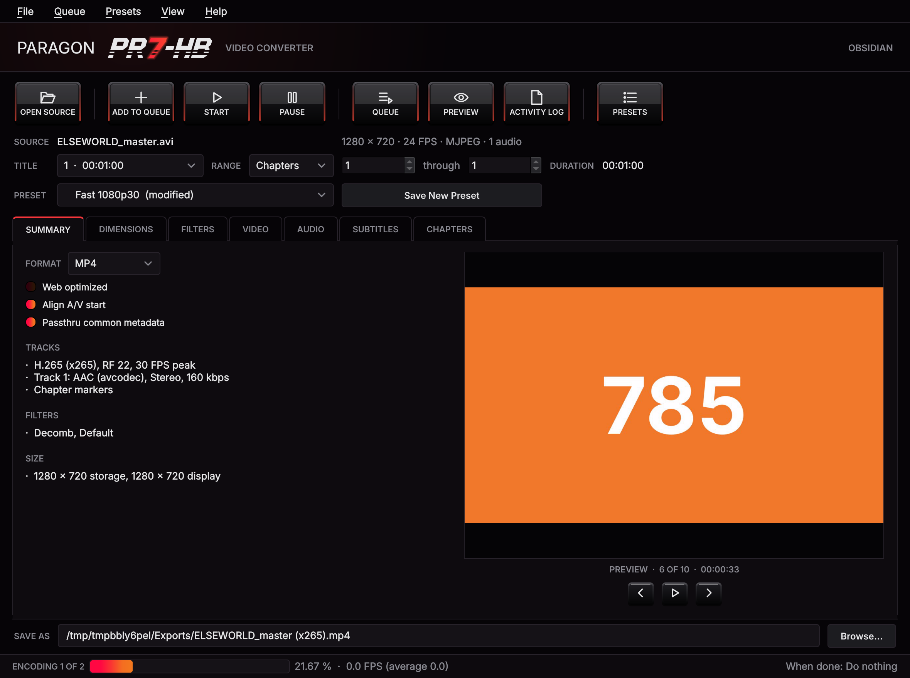
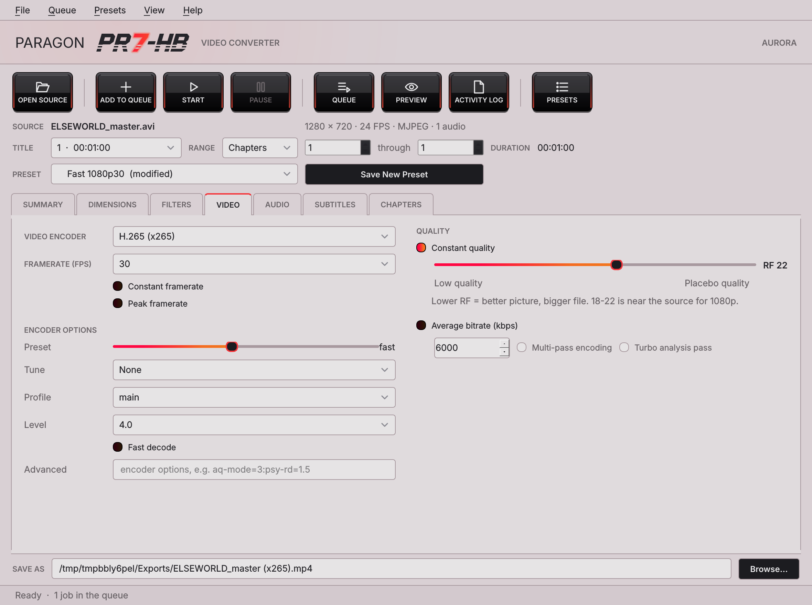

# Paragon PR7-HB

A video converter that works the way **HandBrake** works, in the Paragon family look (PR7-Z, PR7-W, PR7-L, PR7-F,
PR7-E, PR7-R, PR7-P, PR7-M, PR7-Q, PR7-U, PR7-DU, PR7-CB, PR7-IS, PR7-PM, PR7-SM). Python and PySide6.

Every scan and encode runs the official **HandBrakeCLI** (bundled, unmodified), so HandBrake's presets, encoders and
results are exactly HandBrake's: PR7-HB is the window around it.

## What it does

- **Open Source** a video file, a disc folder (VIDEO_TS / BDMV: every title, the main feature first) or a folder of
  videos (Add All queues each one).
- Pick a title and a range (chapters, seconds or frames), a **preset** (HandBrake's own, read from the engine, plus
  yours), then fine-tune in the seven tabs:
  - Summary: container, web optimized, A/V alignment, metadata, the preview.
  - Dimensions: rotation and flip, cropping, resolution limit, anamorphic, upscaling.
  - Filters: detelecine, interlace detection, deinterlace, deblock, denoise, chroma smooth, sharpen, colourspace,
    grayscale.
  - Video: encoder (whatever this machine's HandBrakeCLI offers, GPU encoders included), framerate,
    constant quality or average bitrate (multi-pass), encoder preset, tune, profile, level, advanced options.
  - Audio, Subtitles: the tracks to keep, each with its own encoder, mixdown, bitrate, gain and DRC; foreign audio
    scan, burn-in, forced-only, imported SRT / ASS files.
  - Chapters: markers and their names (import / export HandBrake's chapter files).
- **Add to Queue** / **Start**: the queue runs one job at a time, with progress, speed and time left. Pause, Stop,
  Retry and Remove are there, plus **When done** (do nothing, sleep, shut down, quit). Every job's activity log is
  kept.
- **Preview**: ten frames across the title with the crop shown. The **live preview** encodes 15 seconds with these
  settings and plays them in PR7-M (or your default player).
- **Presets**: save your own, set the default, import and export, all in HandBrake's own preset file format.
- Options: default folder, file names (`{source}`, `{title}`, `{preset}`), what to do when a file exists.

## Building

`pip install -r requirements.txt -r requirements-dev.txt`, put HandBrakeCLI in `engine/` (CI downloads the pinned
release, see `.github/workflows/build.yml`) or on PATH, `python -m pytest`, `pyinstaller pr7hb.spec`, then Inno Setup:
`iscc /DAppVersion=x.y.z installer\pr7hb.iss`.
